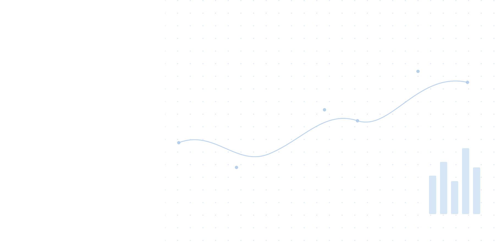

<section class="home-hero">

Hello, I'm

Roza Ghaedi

PhD Researcher at Cardiff University

I work on AI-driven forecasting and fairness-aware machine learning to reduce health screening inequalities, combining graph neural networks, discrete-event simulation, and qualitative research to help build more equitable public health systems.

<a href="mailto:rozaghaedi90@gmail.com" aria-label="E-mail" title="E-mail"><i class="bi bi-envelope"></i></a>
<a href="https://github.com/rozaghaedi" target="_blank" rel="noopener" aria-label="GitHub" title="GitHub"><i class="bi bi-github"></i></a>
<a href="https://www.linkedin.com/in/rosa-ghaedi-b15329231/" target="_blank" rel="noopener" aria-label="LinkedIn" title="LinkedIn"><i class="bi bi-linkedin"></i></a>
<a href="https://scholar.google.com/citations?user=FhUWJo4AAAAJ" target="_blank" rel="noopener" aria-label="Google Scholar" title="Google Scholar"><i class="bi bi-mortarboard-fill"></i></a>

<a class="home-btn home-btn-primary" href="cv/Razieh_Ghaedi_CV.pdf" target="_blank" rel="noopener"><i class="bi bi-download"></i> Download CV</a>
<a class="home-btn" href="about/index.qmd"><i class="bi bi-person"></i> About me</a>

<i class="bi bi-geo-alt-fill"></i> Cardiff University

</section>

<section class="home-section">

What I do

<h2 class="home-h2">Areas of Expertise</h2>

<i class="bi bi-heart-pulse"></i>
<h3>AI for Health Equity</h3>

Forecasting and resource optimisation to reduce health screening inequalities for underserved communities in Wales.

<i class="bi bi-diagram-3"></i>
<h3>Graph Neural Networks</h3>

Spatio-temporal GNNs and attention models for forecasting demand across regions and over time.

<i class="bi bi-shield-check"></i>
<h3>Fairness-Aware ML</h3>

Building well-calibrated, transparent models that perform fairly across different population groups.

<i class="bi bi-gear-wide-connected"></i>
<h3>Simulation &amp; OR</h3>

Discrete-event simulation and operational research, combined with qualitative work, to support service planning.

</section>

<section class="home-section home-facts-band">

7+
Papers &amp; preprints

5
Research projects

3
Academic degrees

7+
Years in software engineering

</section>

<section class="home-section">

Research

<h2 class="home-h2">Recent Publications</h2>

::: {#home-pubs}
:::

<a href="publications/journal_articles/index.qmd">All publications <i class="bi bi-arrow-right"></i></a>
<a href="projects/index.qmd">See my projects <i class="bi bi-arrow-right"></i></a>

</section>

<section class="home-section home-contact">
<h2 class="home-h2">Get in Touch</h2>

I'm always happy to talk about research collaborations in AI for health, forecasting, or fair machine learning.

<a class="home-btn home-btn-primary" href="mailto:rozaghaedi90@gmail.com"><i class="bi bi-envelope"></i> rozaghaedi90@gmail.com</a>
</section>

